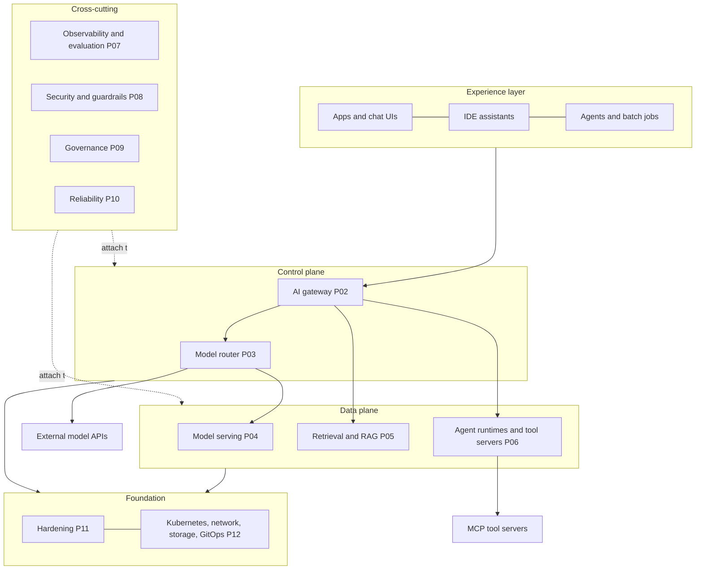

# Reference architecture

> **TL;DR** — The platform is a stack of five layers: an experience layer of consumers, a control plane (gateway, router, policy and identity), a data plane (model serving, retrieval and agent runtimes), a cross-cutting layer (observability, security, governance) and a foundation (Kubernetes, networking, storage, GitOps). All model traffic enters through one AI gateway; every other pillar attaches to it or to the foundation.

*Snapshot: 2026-10-11 · Related: [Methodology](./00-methodology.md) · [Implementation roadmap](./13-implementation-roadmap.md) · [Tool landscape](./14-tool-landscape.md)*

This document is vendor-neutral. It names tool *categories*; the pillar documents choose the tools and carry the evidence for each choice.

## 1. Layers

| Layer | Contents | Owning pillars |
|-------|----------|----------------|
| Experience | Chat front-ends, IDE assistants, applications, batch jobs, agents acting for users. These are consumers, not pillars (see [methodology 2.4](./00-methodology.md#24-deliberate-non-pillars)) | None |
| Control plane | AI gateway, model router, identity and policy decisions | [P02](./02-ai-gateway.md), [P03](./03-model-router.md) |
| Data plane | Inference engines, vector stores, ingestion, agent runtimes, tool servers | [P04](./04-model-serving.md), [P05](./05-data-knowledge-rag.md), [P06](./06-agents-mcp.md) |
| Cross-cutting | Telemetry and evaluation, guardrails and threat defence, governance and cost accountability, resilience | [P07](./07-observability-evaluation.md), [P08](./08-security.md), [P09](./09-governance-risk-compliance.md), [P10](./10-reliability-performance.md) |
| Foundation | Kubernetes, networking, storage, GitOps, infrastructure as code, hardening baseline | [P11](./11-hardening.md), [P12](./12-foundation-infrastructure.md) |

## 2. Request flows

### 2.1 Chat completion

1. The client sends an OpenAI-compatible request with a virtual key to the gateway.
2. The gateway authenticates the key, applies quota and rate limits ([P02](./02-ai-gateway.md)) and runs input guardrail hooks ([P08](./08-security.md)).
3. The router picks a model or endpoint by policy, with fallbacks and canary weights ([P03](./03-model-router.md)).
4. The serving layer runs inference ([P04](./04-model-serving.md)), or the gateway forwards the request to an external provider.
5. Output guardrails run, usage is metered, and the response streams back.
6. A trace with GenAI attributes is emitted for every step ([P07](./07-observability-evaluation.md)).

### 2.2 Retrieval-augmented request

The application (or a gateway hook) embeds the query, queries the vector store, assembles the context and then follows flow 2.1. Retrieval results are untrusted input for prompt-injection purposes ([P08](./08-security.md)). Ingestion runs offline and is described in [P05](./05-data-knowledge-rag.md).

### 2.3 Agent with tools

The agent runtime calls models through the gateway like any other client. Tool calls go to MCP servers, ideally through a tool gateway that applies authorisation and audit; code execution runs in a sandbox ([P06](./06-agents-mcp.md), [P11](./11-hardening.md)). The agent's identity, not the user's, is what the tool sees unless delegation is explicit ([P08](./08-security.md)).

## 3. Cross-cutting attachment points

| Concern | Where it attaches |
|---------|-------------------|
| Identity and authorisation | Gateway (who calls), tool gateway (what an agent may do), workload identity between services |
| Telemetry | Every hop emits OpenTelemetry traces and metrics; the gateway adds token and cost attributes |
| Policy as code | Admission control in the cluster, spend and routing policy at the gateway ([P09](./09-governance-risk-compliance.md)) |
| Caching | Gateway (exact, semantic) and engine (prefix, KV); owned by [P10](./10-reliability-performance.md) |
| Secrets | Provider keys live only in the gateway's secret store; clients never hold them ([P12](./12-foundation-infrastructure.md)) |

## 4. Deployment topologies

| Topology | Shape | Fits when |
|----------|-------|-----------|
| Gateway-only | One gateway fronting commercial model APIs; no GPUs | First step; governance and cost visibility before any hardware |
| Single cluster | Gateway, router and self-hosted inference in one Kubernetes cluster | Most teams after the MVP |
| Multi-cluster / multi-region | Per-region serving with a global gateway tier and failover | Latency, residency or availability targets require it |
| Hybrid | Self-hosted models for sensitive data, external APIs for the rest, one gateway | Mixed data-sensitivity classes |
| Air-gapped | No internet; mirrored images and model artifacts | Regulated or classified environments ([P11](./11-hardening.md)) |

## 5. Design principles

- **One entry point.** All model traffic passes the gateway, so metering, policy and audit have no bypass.
- **Open interfaces.** OpenAI-compatible API, OpenTelemetry, Kubernetes Gateway API, MCP and A2A keep components replaceable.
- **One owner per topic.** See [methodology 2.5](./00-methodology.md#25-one-owner-per-topic).
- **Fail safe.** Every external dependency has a timeout, a fallback and a budget.
- **Provider keys never leave the platform.** Clients get virtual keys only.

## 6. Sources

See the [methodology](./00-methodology.md#7-sources) for the primary sources, and the pillar documents for tool-level evidence. The diagram and flows are this blueprint's own synthesis, not taken from a single upstream document.
