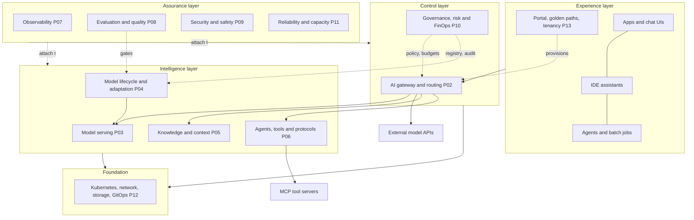

# Reference architecture

> **TL;DR** — The platform is a stack of five layers: an experience layer (the portal, tenancy model and consumers), a control layer (gateway and routing, identity, policy and FinOps), an intelligence layer (model serving, model lifecycle, knowledge and context, agents), an assurance layer (observability, evaluation, security, reliability) and a foundation (Kubernetes, networking, storage, GitOps). All model traffic enters through one AI gateway; every other pillar attaches to it or to the foundation.

*Snapshot: 2026-10-11 · Related: [Methodology](./00-methodology.md) · [Implementation roadmap](./14-implementation-roadmap.md) · [Tool landscape](./15-tool-landscape.md)*

This document is vendor-neutral. It names tool *categories*; the pillar documents choose the tools and carry the evidence for each choice. The twelve pillars (P02 to P13) and how they were derived are in the [methodology](./00-methodology.md#26-review-of-the-original-pillar-list).

## 1. Layers

| Layer | Contents | Owning pillars |
|-------|----------|----------------|
| Experience | Developer portal and catalogue, golden paths, SDKs, tenancy model, usage dashboards. The consumers themselves (chat front-ends, IDE assistants, applications, batch jobs, agents acting for users) are not pillars (see [methodology 2.4](./00-methodology.md#24-deliberate-non-pillars)) | [P13](./13-platform-experience.md) |
| Control | AI gateway and policy routing, identity and virtual keys, policy as code, budgets and FinOps, risk and audit | [P02](./02-ai-gateway-routing.md), [P10](./10-governance-finops.md) |
| Intelligence | Inference engines and inference-aware scheduling, model registry and adaptation, vector stores, memory and prompt assets, agent runtimes and tool servers | [P03](./03-model-serving.md), [P04](./04-model-lifecycle-adaptation.md), [P05](./05-data-knowledge-rag.md), [P06](./06-agents-mcp.md) |
| Assurance | Telemetry, evals and quality gates, guardrails and threat defence, hardening, reliability and capacity | [P07](./07-observability-evaluation.md), [P08](./08-evaluation-quality.md), [P09](./09-security-safety.md), [P11](./11-reliability-capacity.md) |
| Foundation | Kubernetes, networking, storage, GitOps, infrastructure as code, certificates | [P12](./12-foundation-infrastructure.md) |

## 2. Request flows

### 2.1 Chat completion

1. The client sends an OpenAI-compatible request with a virtual key to the gateway.
2. The gateway authenticates the key, applies quota and rate limits ([P02](./02-ai-gateway-routing.md)) and runs input guardrail hooks ([P09](./09-security-safety.md)).
3. The gateway picks a model or endpoint by policy, with fallbacks and canary weights ([P02](./02-ai-gateway-routing.md)).
4. For self-hosted models an inference-aware endpoint picker chooses the replica, for example by prefix-cache affinity and load, and the engine runs inference ([P03](./03-model-serving.md)); otherwise the gateway forwards the request to an external provider.
5. Output guardrails run, usage is metered and tagged with tenant and application, and the response streams back.
6. A trace with GenAI attributes is emitted for every step ([P07](./07-observability-evaluation.md)); sampled traffic can be scored online ([P08](./08-evaluation-quality.md)).

### 2.2 Retrieval-augmented request

The application (or a gateway hook) embeds the query, queries the vector store, assembles the context within a budget and then follows flow 2.1. Retrieval results are untrusted input for prompt-injection purposes ([P09](./09-security-safety.md)). Ingestion runs offline and is described in [P05](./05-data-knowledge-rag.md), together with memory stores and versioned prompt assets.

### 2.3 Agent with tools

The agent runtime calls models through the gateway like any other client. Tool calls go to MCP servers, ideally through a tool gateway that applies authorisation and audit; code execution runs in a sandbox ([P06](./06-agents-mcp.md), [P09](./09-security-safety.md)). The agent has its own non-human identity; delegation on behalf of a user is explicit and short-lived, and side effects pass approval gates ([P06](./06-agents-mcp.md)).

### 2.4 Model change and release (control path)

Not a request flow, but the path that keeps the others safe. A candidate model is catalogued, selected and, where useful, quantised or adapted ([P04](./04-model-lifecycle-adaptation.md)). It is registered with owner and risk metadata ([P10](./10-governance-finops.md)); its artifact is scanned, signed and pulled from an approved store ([P09](./09-security-safety.md)). It is declared in Git and applied by GitOps ([P12](./12-foundation-infrastructure.md)). An evaluation run gates the change ([P08](./08-evaluation-quality.md)). Traffic then shifts by canary weight ([P02](./02-ai-gateway-routing.md)) with a rollback path, while serving capacity follows the SLO ([P03](./03-model-serving.md), [P11](./11-reliability-capacity.md)). Old versions are deprecated on a published schedule ([P04](./04-model-lifecycle-adaptation.md)).

### 2.5 Onboarding a team (consumption path)

A team requests access from the portal ([P13](./13-platform-experience.md)). A golden-path template creates the namespace or virtual cluster, the identity, a virtual key with quota and budget at the gateway ([P02](./02-ai-gateway-routing.md)), a cost tag and a usage dashboard ([P07](./07-observability-evaluation.md), [P10](./10-governance-finops.md)). The team's first call and its first eval set are the exit tests for onboarding.

### 2.6 Pillar coverage

| Pillar | Appears in |
|--------|------------|
| P02 AI gateway and routing | 2.1, 2.2, 2.3 (every model call), 2.4 (canary), 2.5 (keys) |
| P03 Model serving | 2.1 (endpoint picker, inference), 2.4 |
| P04 Model lifecycle and adaptation | 2.4 |
| P05 Knowledge and context | 2.2 |
| P06 Agents, tools and protocols | 2.3 |
| P07 Observability | all flows (telemetry), 2.5 (usage dashboards) |
| P08 Evaluation and quality | 2.1 (online scoring), 2.4 (evaluation gate) |
| P09 Security and safety | 2.1 (guardrails), 2.2 (untrusted retrieval), 2.3 (sandbox), 2.4 (supply chain), section 4 (air-gapped) |
| P10 Governance, risk, compliance and FinOps | 2.4 (registry, policy), 2.5 (budgets), section 3 |
| P11 Reliability, performance and capacity | section 3 (caching), 2.4 (SLO, capacity) |
| P12 Foundation and delivery | 2.4 (GitOps), section 3 (secrets) |
| P13 Platform experience and tenancy | 2.5, section 3 (tenancy) |

## 3. Cross-cutting attachment points

| Concern | Where it attaches |
|---------|-------------------|
| Identity and authorisation | Gateway (who calls), tool gateway (what an agent may do), workload identity between services ([P06](./06-agents-mcp.md), [P09](./09-security-safety.md)) |
| Telemetry | Every hop emits OpenTelemetry traces and metrics; the gateway adds token and cost attributes ([P07](./07-observability-evaluation.md)) |
| Policy as code | Admission control in the cluster, spend and routing policy at the gateway ([P10](./10-governance-finops.md)) |
| Caching | Gateway (exact, semantic) and engine (prefix, KV); owned by [P11](./11-reliability-capacity.md) |
| Secrets | Provider keys live only in the gateway's secret store; clients never hold them ([P12](./12-foundation-infrastructure.md)) |
| Cost and tenancy | The gateway tags every call with tenant and application; cost allocation joins those tags to cluster cost ([P07](./07-observability-evaluation.md)); budgets, showback and chargeback are a process owned by [P10](./10-governance-finops.md); the tenancy model is owned by [P13](./13-platform-experience.md) |
| Quality | Evals gate model, prompt, retrieval, routing and tool changes before release and score sampled traffic after ([P08](./08-evaluation-quality.md)) |
| Capacity | Accelerator quotas, queues and headroom are planned in [P11](./11-reliability-capacity.md) and scheduled by [P03](./03-model-serving.md) and [P04](./04-model-lifecycle-adaptation.md) |

## 4. Deployment topologies

| Topology | Shape | Fits when |
|----------|-------|-----------|
| Gateway-only | One gateway fronting commercial model APIs; no GPUs | First step; governance and cost visibility before any hardware |
| Single cluster | Gateway and self-hosted inference in one Kubernetes cluster, tenants as namespaces | Most teams after the MVP |
| Multi-cluster / multi-region | Per-region serving with a global gateway tier and failover; tenants as virtual or dedicated clusters where isolation demands it | Latency, residency, availability or isolation targets require it |
| Hybrid | Self-hosted models for sensitive data, external APIs for the rest, one gateway | Mixed data-sensitivity classes |
| Air-gapped | No internet; mirrored images, model artifacts and registries; adaptation runs inside the boundary | Regulated or classified environments ([P09](./09-security-safety.md), [P04](./04-model-lifecycle-adaptation.md)) |

## 5. Design principles

- **One entry point.** All model traffic passes the gateway, so metering, policy and audit have no bypass.
- **Open interfaces.** OpenAI-compatible API, OpenTelemetry, Kubernetes Gateway API, MCP and A2A keep components replaceable.
- **One owner per topic.** See [methodology 2.5](./00-methodology.md#25-one-owner-per-topic).
- **Evals gate change.** No model, prompt or route reaches production traffic without a passing evaluation.
- **Fail safe.** Every external dependency has a timeout, a fallback and a budget.
- **Provider keys never leave the platform.** Clients get virtual keys only.
- **The platform is a product.** Self-service, a stable contract and measured adoption matter as much as the components ([P13](./13-platform-experience.md)).

## 6. Sources

See the [methodology](./00-methodology.md#7-sources) for the primary sources and industry reference architectures, and the pillar documents for tool-level evidence. The diagram and flows are this blueprint's own synthesis, not taken from a single upstream document.
