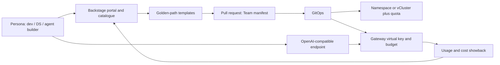

# P13. Platform experience and tenancy

> **TL;DR** — A platform nobody can easily use is not a platform. Treat the AI platform as a product: a developer portal and catalogue (Backstage by default), golden-path templates, self-service onboarding that mints keys and quotas through the gateway, a stable OpenAI-compatible contract, and a tenancy model (namespace-per-team by default, vCluster or dedicated clusters where isolation demands it). Measure adoption and time-to-first-call, not just uptime.

*Snapshot: 2026-10-11 · Related: [Methodology](./00-methodology.md) · [Reference architecture](./01-reference-architecture.md) · [AI gateway and routing](./02-ai-gateway-routing.md) · [Governance and FinOps](./10-governance-finops.md) · [Foundation and delivery](./12-foundation-infrastructure.md)*

## 1. Why it matters

The other pillars decide what the platform can do. This pillar decides whether anyone gets to do it without opening a ticket. Typical failure modes are an excellent gateway that takes three weeks to get a key for, a model catalogue nobody can find, and "multi-tenancy" that is a shared namespace with a naming convention.

This pillar owns:

- the platform-as-a-product mindset, personas and support model;
- the developer portal, service catalogue and golden paths;
- self-service onboarding (team, project, keys, quotas, budgets);
- the client contract: OpenAI-compatible API, SDK guidance and API versioning;
- chat and IDE front-ends offered to end users;
- the tenancy model and its isolation levels;
- usage and cost *visibility* for tenants, and adoption metrics.

It does **not** own the enforcement mechanics. Keys, rate limits and budgets are enforced in [AI gateway and routing](./02-ai-gateway-routing.md); cost allocation policy and chargeback belong to [Governance and FinOps](./10-governance-finops.md); network, pod and identity hardening belong to [Security](./09-security-safety.md); telemetry plumbing belongs to [Observability](./07-observability-evaluation.md). This pillar is the *experience layer* that composes them.

## 2. Capability map

| Capability | What good looks like | Default building block | Boundary |
|------------|----------------------|------------------------|----------|
| Personas and product management | Named personas, a roadmap, a feedback channel, published SLOs | Backstage (portal) plus a product owner | Org design is yours; tooling is the easy part |
| Developer portal and catalogue | One place to find models, APIs, agents, templates, owners and docs | Backstage | Model registry internals belong to [P04](./04-model-lifecycle-adaptation.md) |
| Golden paths and templates | A new service, agent or RAG app starts from a tested template wired to gateway, tracing and evals | Backstage Software Templates | Eval gates belong to [P08](./08-evaluation-quality.md) |
| Self-service onboarding | A team gets namespace, gateway virtual key, quota and dashboards in minutes, via a pull request | GitOps plus Crossplane or kro on a team manifest | Gateway enforcement belongs to [P02](./02-ai-gateway-routing.md) |
| API contract and SDKs | One stable OpenAI-compatible endpoint, versioned, with generated or standard SDKs | Gateway endpoint plus official OpenAI-compatible SDKs | Provider translation belongs to [P02](./02-ai-gateway-routing.md) |
| User front-ends | Sanctioned chat UI with SSO, model access by group and audit | Open WebUI or LibreChat (see licence notes) | Guardrails belong to [P09](./09-security-safety.md) |
| IDE assistants | Coding assistants use the same gateway and keys | Continue (`Apache-2.0`) pointed at the gateway | Agent identity belongs to [P06](./06-agents-mcp.md) |
| Multi-tenancy | Explicit isolation tier per tenant class, enforced by policy | Namespace-per-tenant with quotas, RBAC, NetworkPolicy | Hardening details belong to [P09](./09-security-safety.md) |
| Usage and cost showback | Each team sees its tokens, GPU hours, spend and budget burn | Gateway usage metrics plus OpenCost | Chargeback rules belong to [P10](./10-governance-finops.md) |
| Docs and support | Tutorials, reference, runbooks, an on-call or office-hours model | Docs-as-code (MkDocs Material or Backstage TechDocs) | Incident process belongs to [P11](./11-reliability-capacity.md) |
| Adoption metrics | Time-to-first-call, active teams, golden-path share, satisfaction | Portal and gateway analytics | Quality metrics belong to [P08](./08-evaluation-quality.md) |

## 3. Tool comparison

### 3.1 Portals and catalogues

Defaults here were weighted towards open licensing, plugin ecosystem, neutral foundations and whether the experience layer stays a thin consumer of the other pillars rather than re-implementing them.

| Capability | Default pick | Licence label | Steward | 1-3 alternatives | Key trade-off | Choose the default when... | Do not choose the default when... |
|------------|--------------|---------------|---------|------------------|---------------|----------------------------|-----------------------------------|
| Developer portal | **Backstage** | OSI (`Apache-2.0`) | Backstage project (CNCF incubating, **Opened** in landscape file) | Red Hat Developer Hub (`Apache-2.0`, Backstage distribution, commercial support), Port (SaaS, `Not OSS`), Headlamp plus a docs site for cluster-centric teams | biggest plugin ecosystem and neutral home, but it is a framework you must productise | you have a platform team able to own a TypeScript app and want one catalogue for models, services, templates and docs | you want a turnkey portal with no internal product team or you only need a small cluster UI, not a full platform portal |
| Cluster UI | **Headlamp** | OSI (`Apache-2.0`) | Kubernetes SIG UI (`kubernetes-sigs`) | Kubeflow Central Dashboard (`Apache-2.0`) for ML teams; Kubernetes Dashboard is **archived**, so avoid it | simple and extensible, but it is an operator view rather than a platform-product front door | you need an extensible, plugin-based cluster view that can sit behind or beside the main portal | you expect a cluster UI to replace a service catalogue, onboarding flow or developer portal |
| Docs-as-code | **MkDocs Material** or Backstage **TechDocs** | OSI (`MIT` for Material; Backstage is `Apache-2.0`) | Squidfunk (Material); Backstage project | plain Markdown in the repo | fast docs delivery, but one more publishing path to keep in sync with product reality | docs should live next to code and be indexed in the catalogue | the team cannot yet keep docs current and another rendered site would just fossilise faster |

Port is a commercial SaaS portal; no OSS Port repository was found under that name, so it appears here only as a reference point. Backstage is a framework you assemble and run, not a product you install; budget a small dedicated team.

### 3.2 Self-service and templating

| Capability | Default pick | Licence label | Steward | 1-3 alternatives | Key trade-off | Choose the default when... | Do not choose the default when... |
|------------|--------------|---------------|---------|------------------|---------------|----------------------------|-----------------------------------|
| Team resource composition | **Crossplane** | OSI (`Apache-2.0`) | Crossplane project (CNCF graduated) | kro (`Apache-2.0`, Kubernetes SIG Cloud Provider hosted - steward **Unverified**), Helm plus GitOps ApplicationSets | strongest self-service abstraction, but it needs careful platform API design | one `Team` or `AIProject` manifest should expand into namespace, quota, policy and gateway key | the platform is too small to justify another abstraction layer beyond reviewed IaC modules |
| Software templates | **Backstage Software Templates** | OSI (`Apache-2.0`) | Backstage project | Cookiecutter-style repos, Azure Developer CLI templates (`MIT`, `azd`) | best portal integration, but tied to Backstage if that is not already your front door | templates should open a pull request in the same portal teams already use | the portal is not Backstage or teams only need repository scaffolding with no catalogue workflow |
| Dev environments | **Coder** | OSI (`AGPL-3.0`) | Coder Inc. | devfile-based tools, plain devcontainers | governed remote workspaces, but with AGPL and vendor-led product direction | you need governed cloud workspaces with GPU access; check AGPL fit | local devcontainers are enough and you do not need centrally managed remote environments |

### 3.3 Identity and SSO for the experience layer

P09 owns identity *policy*; this section compares the experience-layer fit for portals, chat UIs and onboarding.

| Capability | Default pick | Licence label | Steward | 1-3 alternatives | Key trade-off | Choose the default when... | Do not choose the default when... |
|------------|--------------|---------------|---------|------------------|---------------|----------------------------|-----------------------------------|
| Front-end SSO and group sync | **Keycloak** | OSI (`Apache-2.0`) | Keycloak project | Authentik (`Open-core`, MIT outside `enterprise/`), Dex (`Apache-2.0`), existing enterprise IdP (`Not OSS`) | richest self-service IAM, but also the heaviest operationally | the portal, chat UI and onboarding flows need one self-hosted OIDC/SAML broker with group and realm features | a lightweight OIDC bridge to an existing IdP is enough, where Dex may be simpler |

### 3.4 Builder studios and front-ends

Builder studios are **not** a replacement for the portal, runtime or governance stack. They are self-service surfaces for internal builders on top of the gateway and the approved tool catalogues.

| Capability | Default pick | Licence label | Steward | 1-3 alternatives | Key trade-off | Choose the default when... | Do not choose the default when... |
|------------|--------------|---------------|---------|------------------|---------------|----------------------------|-----------------------------------|
| Visual AI app / agent studio | **Langflow** | OSI (`MIT`) | Langflow project | Dify (`Source-available`, modified Apache-2.0 with multi-tenant restriction), Flowise (`Open-core`, archived repository), low-code-free golden paths only | cleanest licence and active upstream, but it is a builder surface rather than a governed platform control plane | internal builders need a visual composition surface wired to approved gateway endpoints and tools | you really need a portal, a registry or a multi-tenant product shell rather than a flow builder |
| Chat UI | **LibreChat** | OSI (`MIT`, **Opened**) | LibreChat project (repo now at `LibreChat-AI/LibreChat`) | Open WebUI (`Source-available`, branding clause), Hugging Face chat-ui (`Apache-2.0`), Dify (`Source-available`) | clean licence and multi-provider support, but less ecosystem gravity than Open WebUI | you want a permissive licence, SSO and multi-provider support with no redistribution constraints | the team wants to customise or rebrand the UI heavily and the chosen front-end licence gets in the way |
| Local desktop chat | **Jan** | **Unverified** (GitHub reports no SPDX; the notice names Menlo Research) | Menlo Research | LM Studio and similar (`Not OSS`) | easy local testing, but not a shared governed platform surface | individual local use, not a shared platform front-end | you need central audit, SSO and shared policy enforcement |
| IDE assistant | **Continue** | OSI (`Apache-2.0`) | Continue Dev | commercial assistants (`Not OSS`) | easiest gateway-aligned path for developers, but still another client to document and support | developers should reach models through your gateway, not personal keys | your security model forbids IDE plug-ins or you cannot support another client surface |

Licence watch:

- **Open WebUI** is no longer plain BSD-3. Its `LICENSE` is a BSD-3-style text plus a clause that forbids altering, removing or replacing the "Open WebUI" branding unless you have 50 or fewer end users in any rolling 30 days, written permission, or an enterprise licence (**Opened** in this review). Label it `Source-available` for platform decisions; legal should read the current text, since it has changed before.
- **Dify** uses a modified Apache-2.0 licence with additional conditions, including a multi-tenant restriction and frontend branding requirements. Treat it as `Source-available`, not OSI.
- **Flowise** now mixes Apache-2.0 code with commercial enterprise directories and its GitHub repository is archived (**Opened**); it is not a safe default for new platform bets.
- **LobeChat** (now `lobehub/lobehub`) is also under a community licence derived from Apache-2.0 (**Opened**). LibreChat's `MIT` text remains the clean choice.

Notes:

- Licence, stars, archive flag and activity were checked on 2026-10-11 via GitHub (**Opened**) and re-checked selectively in this review. Langflow was at about 155.8k★ with latest release `v1.12.6`; Dify at about 158.7k★ with latest release `1.17.1`; Flowise at about 55.5k★ but archived.
- vCluster, Capsule and tenancy tools are in §3.5.
- Why the defaults: Backstage wins on adoption, foundation home and plugin ecosystem; Keycloak is the best experience-layer IAM fit when you need a self-hosted broker; Langflow wins the builder-studio slot on licence clarity; LibreChat wins on licence signal over the more popular Open WebUI.

### 3.5 Tenancy tools

| Capability | Default pick | Licence label | Steward | 1-3 alternatives | Key trade-off | Choose the default when... | Do not choose the default when... |
|------------|--------------|---------------|---------|------------------|---------------|----------------------------|-----------------------------------|
| Namespace tenancy | **Namespaces + `ResourceQuota` + RBAC + `NetworkPolicy`** | OSI (`Apache-2.0`, Kubernetes) | Kubernetes project | Capsule (`Apache-2.0`, CNCF sandbox) to group namespaces into tenants | simplest model and easiest to explain, but it is still soft multi-tenancy on one control plane | teams are internal and trusted and you want the simplest model | tenants need their own CRDs, admission stack or control-plane blast-radius boundary |
| Tenant abstraction | **Capsule** | OSI (`Apache-2.0`) | Capsule project (CNCF sandbox) | Kubernetes Hierarchical Namespaces (`Apache-2.0`, **archived**), Kyverno policies | delegated namespace administration without a new control plane, but still soft multi-tenancy | tenants own several namespaces and need delegated administration with guardrails | hard isolation or CRD-level separation is required, where vCluster or a dedicated cluster fits better |
| Virtual clusters | **vCluster** | OSI (`Apache-2.0`) | Loft Labs | Kamaji (`Apache-2.0`) and HyperShift (`Apache-2.0`) for hosted control planes | strongest isolation before a dedicated cluster, but still shares worker nodes unless you isolate them too | tenants need their own API server, CRDs or admission webhooks without a cluster each | regulatory or hostile-tenant requirements need a real cluster boundary, or hosted control planes such as Kamaji fit the ops model better |
| Dedicated clusters | **Cluster API** | OSI (`Apache-2.0`) | Kubernetes SIG Cluster Lifecycle | cloud-managed cluster APIs (`Not OSS`) | strongest isolation, but the highest operational and cost burden | hard isolation, regulatory separation or noisy-neighbour GPU risk justify a real cluster per tenant | the tenant profile does not justify the extra control planes, upgrades and fleet management |

Hierarchical Namespaces (HNC) moved to `kubernetes-retired` and is archived (**Opened**, last push 2025-04-07). Do not choose it for new designs; Capsule or policy-driven namespace trees replace it.

## 4. Reference design



Flow:

1. A developer picks a template in the portal ("RAG service", "agent with MCP tools", "batch eval job").
2. The template creates a repository and a pull request adding a `Team` or `AIProject` manifest.
3. After review, GitOps reconciles it into a namespace (or vCluster), `ResourceQuota`, RBAC bindings, NetworkPolicy and a gateway virtual key with model allow-list, rate limit and budget.
4. The developer calls one OpenAI-compatible URL with that key; the gateway routes ([P02](./02-ai-gateway-routing.md)) and serving handles inference ([P03](./03-model-serving.md)).
5. Usage and cost flow back to the portal as team dashboards ([P07](./07-observability-evaluation.md), [P10](./10-governance-finops.md)).

### Personas

| Persona | Primary need | Entry point | Typical guardrail |
|---------|--------------|-------------|-------------------|
| App developer | Call a model reliably from a service | Gateway key, SDK, template | Model allow-list, rate limits |
| Data scientist | Notebooks, fine-tuning, GPU jobs | Kubeflow or notebook templates, Kueue queue | GPU quota, queue priority ([P12](./12-foundation-infrastructure.md)) |
| Agent builder | Tools, MCP servers, agent identity | Agent template, MCP catalogue ([P06](./06-agents-mcp.md)) | Tool allow-lists, human approval |
| Platform operator | Healthy fleet, clean upgrades | Headlamp, runbooks, alerts | Change control |
| Auditor | Evidence without engineering help | Read-only portal views, audit exports | Separation of duties ([P10](./10-governance-finops.md)) |

### Tenancy models

| Model | Isolation | Cost | Choose when | Residual risk |
|-------|-----------|------|-------------|---------------|
| Shared namespace with labels | Weak (convention only) | Lowest | Never beyond a single team demo | Cross-team access, quota fights |
| Namespace per tenant (soft) | Medium: RBAC, quota, NetworkPolicy, Pod Security | Low | Trusted internal teams on shared GPUs | Shared kernel, shared control plane, cluster-scoped CRDs |
| Capsule tenant (soft, delegated) | Medium plus policy-enforced namespace trees | Low | Tenants self-manage several namespaces | Same shared control plane |
| vCluster (firmer) | Own API server and CRDs; workloads still share nodes unless you add node isolation | Medium | Tenants need CRDs or admission control of their own | Node-level escape paths; add dedicated node pools |
| Dedicated cluster (hard) | Strongest | Highest | Regulated data, external customers, strict GPU isolation | Operational sprawl; needs Cluster API automation |

Soft tenancy assumes mutually trusting tenants; hard tenancy assumes hostile ones. Sandbox runtimes and node pools per tenant belong in [P09](./09-security-safety.md). Whatever you pick, the tenant identity must be the same string in the namespace, the gateway key, the OpenCost labels and the audit log.

## 5. Implementation guide

A minimal tenant declaration that the platform expands (illustrative composite resource; field names are yours to define):

```yaml
apiVersion: platform.example.org/v1
kind: AIProject
metadata:
  name: support-assistant
spec:
  team: support-eng
  tenancy: namespace        # namespace | vcluster | cluster
  gpuQuota: { class: shared, hours: 200 }
  gateway:
    models: [chat-default, embed-default]
    monthlyBudgetUsd: 2000
    requestsPerMinute: 600
  owners: [group:support-eng]
```

And the base isolation it should generate for the namespace tier:

```yaml
apiVersion: v1
kind: ResourceQuota
metadata: { name: tenant-quota, namespace: support-assistant }
spec:
  hard:
    requests.cpu: "40"
    requests.memory: 160Gi
    requests.nvidia.com/gpu: "2"
---
apiVersion: networking.k8s.io/v1
kind: NetworkPolicy
metadata: { name: default-deny, namespace: support-assistant }
spec:
  podSelector: {}
  policyTypes: [Ingress, Egress]
```

Practical advice:

- **Contract.** Publish one base URL and the OpenAI-compatible subset you guarantee (chat completions, embeddings, models; mark anything else best-effort). Keep an OpenAPI description, lint it (Spectral, `Apache-2.0`) and diff it in CI (oasdiff, `Apache-2.0`) to catch breaking changes. The upstream `openai-openapi` spec (`MIT`) is a useful baseline (**Opened**).
- **Versioning.** Version the platform contract separately from model names: use stable *aliases* (`chat-default`) that [P02](./02-ai-gateway-routing.md) maps to concrete models, so model upgrades from [P04](./04-model-lifecycle-adaptation.md) do not break clients. Announce deprecations with dates, emit a response header for deprecated aliases and keep at least one overlap window.
- **SDKs.** Prefer the standard OpenAI-compatible client libraries pointed at your base URL. Generate thin wrappers (OpenAPI Generator, `Apache-2.0`) only for platform-specific APIs such as key self-service. Do not fork SDKs.
- **Onboarding by pull request.** Everything a team gets should be code in Git, reviewed once, so offboarding and audits are the reverse operation.
- **Front-ends.** Put chat UIs behind SSO (Keycloak or Dex, see [P09](./09-security-safety.md)), map groups to model allow-lists, and route them through the gateway rather than direct to providers.
- **Showback.** Label tenant workloads consistently and give OpenCost (`Apache-2.0`, CNCF incubating) plus gateway token counts a per-team dashboard; charge-back rules stay in [P10](./10-governance-finops.md).

## 6. Operations

- Treat the portal and templates as a product: a backlog, release notes, a deprecation policy and a named owner.
- Run office hours and a triage channel with a first-response target; tag requests by persona.
- Review catalogue freshness monthly: orphaned services, missing owners, stale docs.
- Re-test golden paths on every platform upgrade; a template that stops working is an outage for new teams.
- Review quotas and budgets quarterly with tenants, using showback data.
- Track tenancy exceptions (shared namespaces, elevated RBAC) in a register with expiry dates.

### Adoption metrics (DORA-style for an AI platform)

Borrow the spirit of DORA: few, outcome-oriented, comparable over time. These are **editorial proposals** (**Unverified** as a standard), not an established benchmark.

| Metric | Definition | Direction |
|--------|------------|-----------|
| Time to first call | Request for access to first successful gateway call | Down |
| Time to first production | First call to first production deployment via a golden path | Down |
| Golden-path share | Share of new services created from a template | Up |
| Active teams | Teams with gateway traffic in the last 30 days | Up |
| Self-service ratio | Onboardings completed without a human ticket | Up |
| Platform change failure rate | Platform releases that cause tenant impact | Down |
| Support time to resolve | Median time to close a tenant request | Down |
| Developer satisfaction | Quarterly survey (for example NPS or a short CSAT) | Up |

Pair these with the original DORA four keys for the platform's own delivery, and keep model quality metrics in [P08](./08-evaluation-quality.md).

## 7. Pitfalls

- Building the portal before the golden path works; a catalogue of broken links teaches teams to ignore it.
- Calling a shared namespace "multi-tenancy".
- Adopting Open WebUI or LobeChat org-wide without reading their licence terms.
- Exposing concrete model names in client code, so every model swap becomes a breaking change.
- Backstage as a side project: it needs a real owner, upgrades and plugin curation.
- Quotas on CPU but not GPU, or budgets in the gateway but not in the namespace.
- Different tenant identifiers in Kubernetes, the gateway and billing, which breaks showback.
- Choosing archived tooling (Kubernetes Dashboard, Hierarchical Namespaces) because older guides recommend it.
- Treating vClusters as hard isolation while sharing nodes with sensitive tenants.
- Measuring only platform uptime and never asking developers.

## 8. Checklist

### MVP

- [ ] Define personas and one owner for the platform product.
- [ ] Publish one OpenAI-compatible base URL with stable model aliases.
- [ ] Onboard a team via a reviewed pull request that creates namespace, quota and gateway key.
- [ ] Apply namespace-per-team with ResourceQuota, RBAC and default-deny NetworkPolicy.
- [ ] Provide a quick-start doc that reaches a first call in under 30 minutes.

### Production

- [ ] Stand up a catalogue and at least three golden-path templates.
- [ ] Gate contract changes with OpenAPI lint and diff in CI.
- [ ] Offer a sanctioned chat UI with SSO and group-based model access; licence-reviewed.
- [ ] Decide whether any visual builder studio is sanctioned, and if so route it through the same gateway, identity and policy path as code-built apps.
- [ ] Give every team a usage and cost dashboard (tokens, GPU hours, budget burn).
- [ ] Run a support rota or office hours and publish a deprecation policy.
- [ ] Track the adoption metrics monthly.

### Enterprise

- [ ] Offer tiered tenancy (namespace, vCluster, dedicated cluster) with documented selection criteria.
- [ ] Standardise one front-end SSO and group-sync path for portal, chat and builder surfaces.
- [ ] Enforce node-pool or sandbox isolation for hostile or regulated tenants.
- [ ] Automate tenant offboarding, key revocation and data deletion.
- [ ] Provide auditors read-only evidence views with no engineering intermediary.
- [ ] Run developer-experience surveys and feed results into the roadmap.
- [ ] Keep a licence watch on front-ends and portal distributions.

## 9. Sources

- [Backstage](https://github.com/backstage/backstage), [Red Hat Developer Hub](https://github.com/redhat-developer/rhdh), [Backstage Software Templates](https://backstage.io/docs/features/software-templates/)
- [Headlamp](https://github.com/kubernetes-sigs/headlamp), [Kubeflow](https://github.com/kubeflow/kubeflow), [Kubernetes Dashboard (archived)](https://github.com/kubernetes-retired/dashboard)
- [Open WebUI](https://github.com/open-webui/open-webui) and its [LICENSE](https://github.com/open-webui/open-webui/blob/main/LICENSE), [LibreChat](https://github.com/LibreChat-AI/LibreChat), [LobeChat](https://github.com/lobehub/lobehub), [Hugging Face chat-ui](https://github.com/huggingface/chat-ui), [Jan](https://github.com/janhq/jan), [Continue](https://github.com/continuedev/continue), [Dify](https://github.com/langgenius/dify), [Flowise](https://github.com/FlowiseAI/Flowise), [Langflow](https://github.com/langflow-ai/langflow)
- [Capsule](https://github.com/projectcapsule/capsule), [vCluster](https://github.com/loft-sh/vcluster), [Kamaji](https://github.com/clastix/kamaji), [HyperShift](https://github.com/openshift/hypershift), [Cluster API](https://github.com/kubernetes-sigs/cluster-api), [Hierarchical Namespaces (archived)](https://github.com/kubernetes-retired/hierarchical-namespaces)
- [Kubernetes multi-tenancy docs](https://kubernetes.io/docs/concepts/security/multi-tenancy/)
- [Crossplane](https://crossplane.io/), [kro](https://github.com/kubernetes-sigs/kro), [Coder](https://github.com/coder/coder), [Azure Developer CLI](https://github.com/Azure/azure-dev), [Keycloak](https://github.com/keycloak/keycloak), [Dex](https://github.com/dexidp/dex), [Authentik](https://github.com/goauthentik/authentik)
- [OpenCost](https://github.com/opencost/opencost), [MkDocs Material](https://github.com/squidfunk/mkdocs-material)
- [openai-openapi](https://github.com/openai/openai-openapi), [Spectral](https://github.com/stoplightio/spectral), [oasdiff](https://github.com/oasdiff/oasdiff), [OpenAPI Generator](https://github.com/OpenAPITools/openapi-generator)
- [DORA](https://dora.dev/) for the four keys referenced in the adoption metrics
- [CNCF landscape file](https://github.com/cncf/landscape/blob/master/landscape.yml)
- [Methodology](./00-methodology.md) for the licence legend, evidence grades and refresh commands
